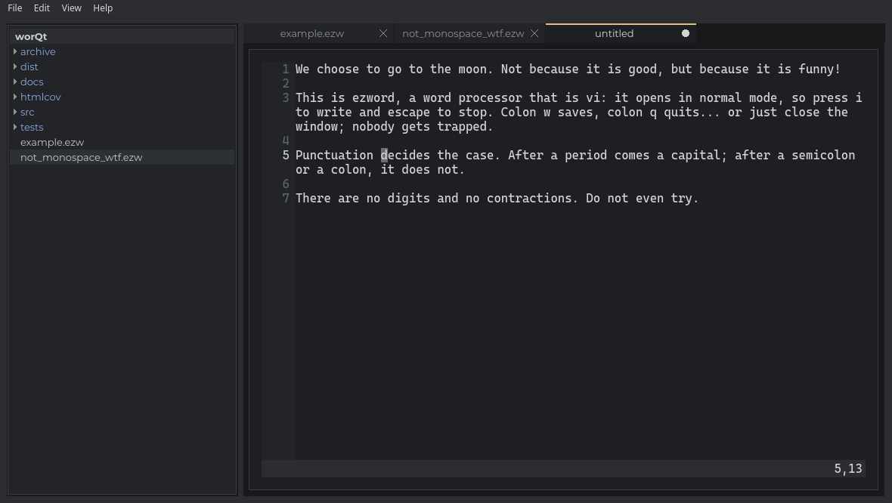

# worQt
The worQt module expands on worktoy with utilities for use with pyside6

## Try EZWord

EZWord is a word processor made entirely of worQt's own painted widgets,
and it is Vi.



```bash
PYTHONPATH=src python -m worQt.ezword
```

- It opens in Normal mode, as Vi does: `i` to write, Esc to stop, `:w` to
  save, `:q` to quit. Motions, operators, counts, `.`, search, undo and
  scrolling work as you would expect from Vim.
- Nobody gets trapped: a click puts the cursor where it lands, the File
  menu and Ctrl+S work in every mode, and closing the window asks before
  throwing unsaved changes away.
- Punctuation decides the case. Letters have no case of their own: a
  sentence starts with a capital after `.`, `?` or `!`, and stays in
  lower case after `;`, `:` or `...`.
- The text holds letters, spaces, commas, line breaks and punctuation,
  nothing else: no digits, and no contractions, so write "do not".
- Files are plain text with the `.ezw` extension, in the format's own
  rendering: blank lines between paragraphs. The browser on the left
  shows the ones around you; double click one to open it.
- Every file opens in a tab of its own: `gt` and `gT`, or Ctrl+PageDown
  and Ctrl+PageUp, go from tab to tab, and `:tabnew` opens a new one.
- `:wq` saves and closes the tab, not EZWord.

The editing widget, the `Vidget` in `worQt.vidget`, is not tied to
EZWord: any worQt application can use it for its own text.
